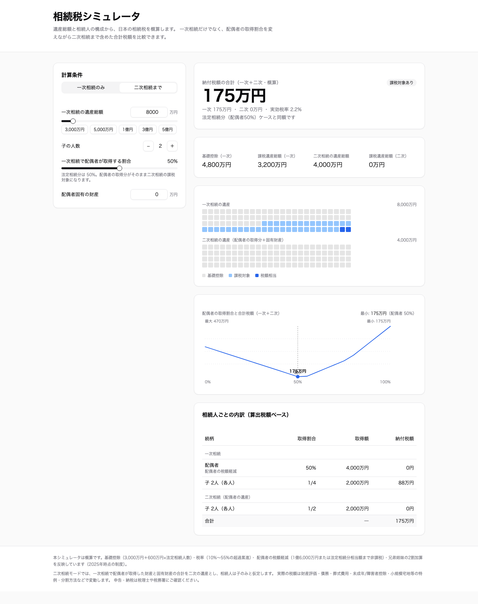

# 相続税シミュレータ

日本の相続税をブラウザ上で概算できるウェブアプリです。
一次相続だけでなく、**配偶者の取得割合を変えながら二次相続まで含めた合計税額**をシミュレーションできます。

🔗 **公開URL**: https://torufree123.github.io/souzoku-zei-simulator/



## 主な機能

- **一次相続モード** … 遺産総額と相続人構成（配偶者・子・父母・兄弟姉妹）から税額を概算
- **二次相続モード** … 一次相続で配偶者が取得する割合（0〜100%）を動かし、一次＋二次の合計税額を比較
- **感応度チャート** … 配偶者の取得割合と合計税額の関係を可視化し、税額が最小になる割合を自動表示
- **法定相続分ケースとの差額** … 配偶者50%取得の場合との増減を自動比較
- **相続人ごとの内訳表** … 続柄・取得割合・取得額・納付税額を一次/二次別に表示
- 遺産総額プリセット（3,000万〜5億円）、ダークモード、レスポンシブ対応

## 計算の前提（2025年時点の制度）

- 基礎控除: 3,000万円 ＋ 600万円 × 法定相続人数
- 税率: 10%〜55% の超過累進課税（速算表）
- 配偶者の税額軽減: 1億6,000万円 または 法定相続分相当額 のいずれか多い方まで非課税
- 兄弟姉妹は 2割加算
- 二次相続モードでは、一次で配偶者が取得した財産（＋固有財産）を二次の遺産とし、相続人は子のみと仮定

> ⚠️ 本アプリは概算ツールです。実際の税額は財産評価・債務・葬式費用・各種控除・小規模宅地等の特例などで変動します。申告・納税は税理士や税務署にご確認ください。

## 技術スタック

- React 19 + TypeScript + Vite
- Tailwind CSS + shadcn/ui
- 計算ロジック: [`src/lib/tax.ts`](src/lib/tax.ts)（UI から独立した型付きモジュール）

## ローカル開発

```bash
npm install
npm run dev       # 開発サーバー（HMR）
npm run build     # 本番ビルド → dist/
npm run preview   # ビルドのローカル確認
```

## デプロイ

`main` ブランチへのプッシュで GitHub Actions が自動的にビルド＆ GitHub Pages へ公開します
（ワークフロー: [`.github/workflows/deploy.yml`](.github/workflows/deploy.yml)）。
